# Hi there, I'm Fabian 👋

  
  
  

---

## 👨‍💻 About Me

Software developer in the mechanical engineering sector, specialising in **simulation** and **control engineering**. In my spare time I build useful side projects and keep websites running for friends.

- ⚙️ **Day job:** Simulation & control software in mechanical engineering
- 🎓 **Studying:** M.Sc. Applied Computer Science
- 🛠️ **Side projects:** Useful apps, plus content about my Christian faith
- 🌐 **Web:** Maintaining and improving websites for friends

---

## 🛠️ Tech Stack

### Languages

  
  
  
  
  
  
  
  

### Frameworks & Engines

  
  
  
  

### Tools & DevOps

  
  
  
  
  
  

---

## 📊 GitHub Stats

<picture>
  <source media="(prefers-color-scheme: dark)" srcset="https://github-stats-extended-fabiveloper.vercel.app/api?username=fabiveloper&hide=contribs&hide_rank=true&show_icons=true&include_all_commits=true&count_private=true&bg_color=0D1117&title_color=39D353&icon_color=39D353&text_color=FFFFFF&hide_border=true" />
  
</picture>
<picture>
  <source media="(prefers-color-scheme: dark)" srcset="https://github-stats-extended-fabiveloper.vercel.app/api/top-langs?username=fabiveloper&layout=compact&langs_count=6&bg_color=0D1117&title_color=39D353&text_color=FFFFFF&hide_border=true" />
  
</picture>

<picture>
  <source media="(prefers-color-scheme: dark)" srcset="https://streak-stats.demolab.com?user=fabiveloper&hide_border=true&background=0D1117&ring=39D353&fire=39D353&currStreakLabel=39D353&currStreakNum=FFFFFF&sideNums=FFFFFF&sideLabels=FFFFFF&dates=8B949E&stroke=30363D" />
  
</picture>

### <picture><source media="(prefers-color-scheme: dark)" srcset="assets/activity-dark.svg"></picture> Activity

<picture>
  <source media="(prefers-color-scheme: dark)" srcset="https://raw.githubusercontent.com/fabiveloper/fabiveloper/output/pacman-contribution-graph-dark.svg">
  <source media="(prefers-color-scheme: light)" srcset="https://raw.githubusercontent.com/fabiveloper/fabiveloper/output/pacman-contribution-graph.svg">
  
</picture>

Generated with <a href="https://abozanona.github.io/pacman-contribution-graph/">abozanona/pacman-contribution-graph</a>

---

## 📫 Get in Touch

  
  
  

